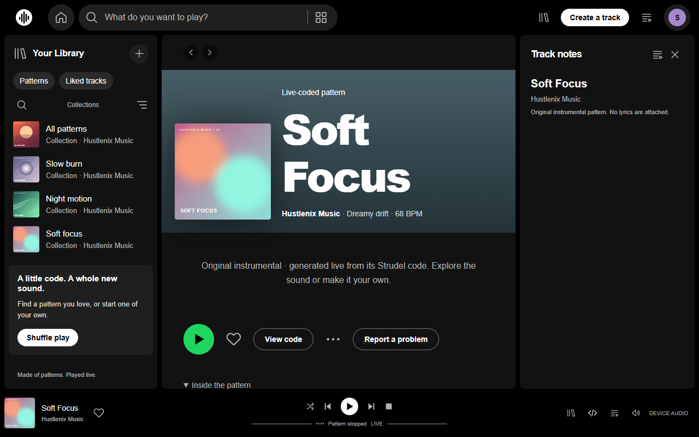
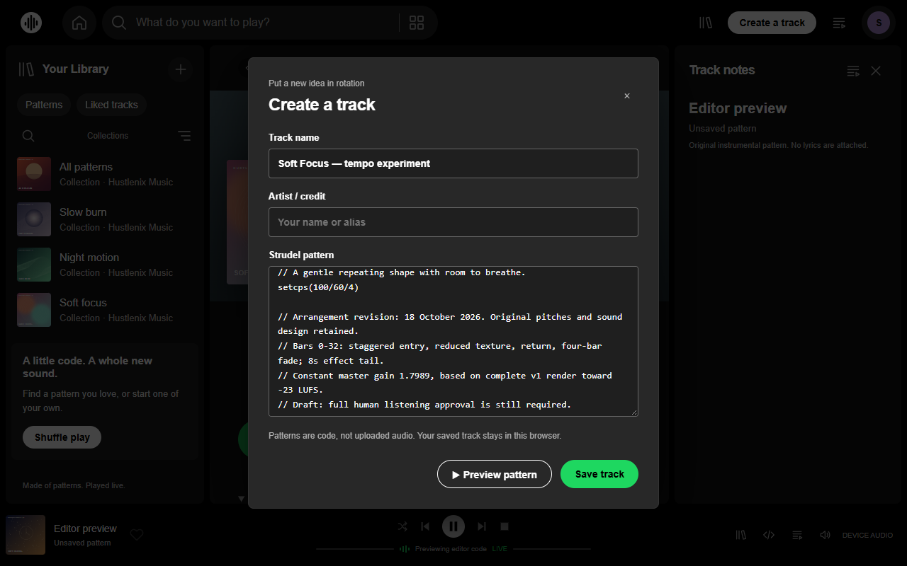
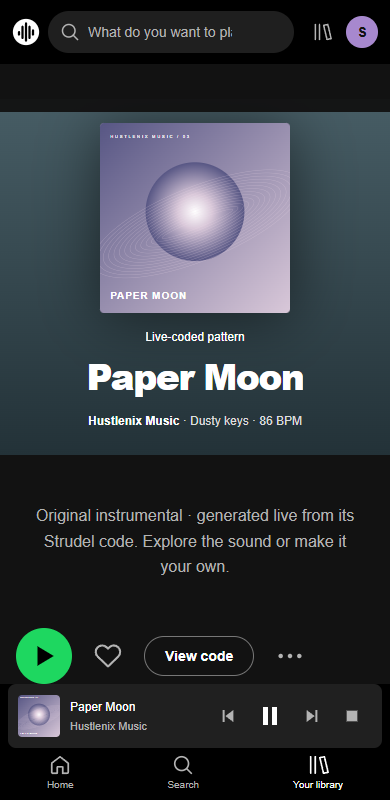

# Public walkthrough

[Watch the 45-second MP4](media/hustlenix-music-walkthrough.mp4)

This records the real public beta at https://hustlenix.github.io/strudelify/ . It was captured
in an isolated Chromium session operated by Codex. The soundtrack comes from that browser's
live WebAudio output. Captions sit below the captured application area.

| Time | Actual action |
| --- | --- |
| 0–5s | Play Paper Moon |
| 5–13s | Switch to Soft Focus, pause, resume and Stop |
| 13–18s | Open the selected composition's actual source |
| 18–26s | Copy the score into the local editor and change its tempo from 68 to 100 BPM |
| 26–34s | Preview the edited code; the actual scheduler runs at 100 BPM |
| 34–45s | Close the preview, use the responsive 390px layout, play and Stop |

The edit is a local preview and was not saved to the public catalog. The mobile portion uses
browser emulation. This recording is not an independent human listening review or a physical-phone test.

## Screenshots

### Desktop player

### Live code preview

### Responsive player

## Recording evidence

[Capture provenance](demo-provenance.json) records the source commit, actions, source/edit hashes,
actual scheduler tempo, audible segments, silent Pause/Stop intervals, duration and MP4 hash.
The final file passed a complete decode and is 45 seconds, H.264/AAC, 1280×880.

The existing SVG covers visible inside the app were generated with Codex; a genuine screen
recording does not change their authorship. Audio placement uses capture-callback wall time,
with synchronization limited by one processing block and browser callback latency.

For reproducibility, recording and encoding helpers are in `release-audit/public-demo/`.
Raw video, intermediate audio and failed recording attempts remain outside the public site artifact.
