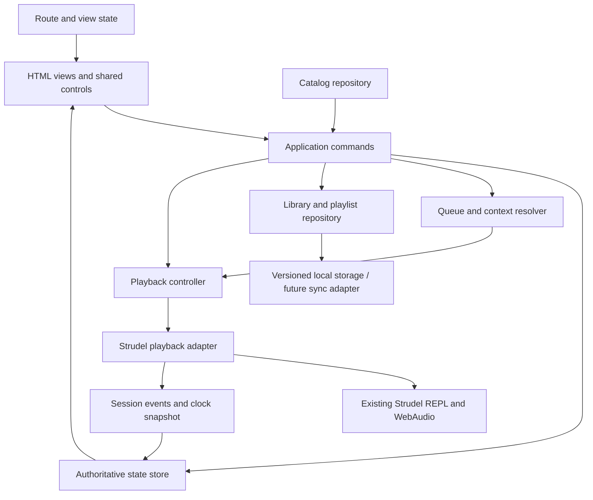

# Framework findings and Strudelify architecture mapping

This separates **recovered public facts**, **published historical design** and **our proposed implementation**. Evidence IDs are defined in [SOURCES.md](SOURCES.md). No architecture implementation is included in this branch.

## 1. What the framework evidence establishes

| Finding | Evidence | Confidence / boundary |
| --- | --- | --- |
| Desktop and mobile web build families | P1/P2 resource URLs | Direct current resource fact; no claim about all clients or experiments |
| Main/vendor/design-system chunks | P1/P3 linked filenames | Direct code-delivery structure; filenames alone do not recover module ownership |
| React-family artifact content | P3 `react.element`, `react-dom`, `createRoot` markers | Direct static fingerprints, which can include compatibility/unused code |
| `react-dom` version `18.3.1` declaration | P3 renderer-package declaration | Direct literal in inspected vendor artifact; not a measured active runtime |
| Redux markers | P3 string offsets; H1 historical article | Not enough to assert a complete current Redux store architecture or version |
| Shared component foundation | P2 `encore` token vocabulary; H3/H4 | Current CSS vocabulary plus published design-system explanation |
| UI/platform separation | H2 | Published 2021 design; useful pattern, not a freshly recovered 2026 source tree |
| Backend/service internals | No capture | Unknown; neither public page assets nor an SDK document reveals all service code |

Spotify's [2019 account](https://engineering.atspotify.com/2019/3/building-spotifys-new-web-player) describes React/Redux. Its [2021 architecture](https://engineering.atspotify.com/2021/04/building-the-future-of-our-desktop-apps) describes a React UI using TypeScript platform APIs/hooks across native and web playback/data stacks. Those dates matter. Do not copy a blog-era library list into a supposedly current dependency manifest.

**Decision for Strudelify (I):** retain the HTML/CSS/JavaScript app and extract small modules around state and capabilities. Adopt shared components, a single state flow and a playback/data facade. Evaluate a framework migration separately if the actual component complexity warrants it. Our current Strudel runtime and static hosting remain usable.

## 2. Current source audit

Pinned base: `7c6ac654ba2bad98a8c42cd8a1c65d346b660582`. Symbols below are the checked source, not an inferred Spotify implementation.

| Current area | Existing strength to preserve | Gap for the reference behavior |
| --- | --- | --- |
| `state` / local storage (`app.js:24`) | Likes, custom tracks and recents already persist | No playlist entities, queue entries, context, repeat or durable shuffle mode |
| `playTrack` (`165`) | Revision cancellation, aborts, serialized REPL evaluation, instrument preparation, session-tagged output | Many UI mutations are interleaved with engine operations; expose a stable snapshot/command interface |
| `silenceEngine` / `stopTrack` (`129` / `232`) | Stops scheduling, hushes, disconnects effects and suspends output | Preserve all these semantics through refactoring; a UI flag alone is insufficient |
| `togglePlayback` (`247`) | AudioContext suspend/resume preserves phase | Transport/card/row actions need one consistent intent model |
| `renderQueue` (`342`) | Existing right-panel renderer | Lists every track and plays immediately; no upcoming ordering/edit operations |
| Previous/Next (`571`) | Works over `allTracks()` | Ignores collection context, queue and listening history |
| Shuffle (`579`) | One random-track selection | Changes a class and calls `playRandom()`; mode does not determine later Next |
| Library (`415`) | Likes and created filters | “All” is the entire catalog; saved entities and editable collections need their own model |
| Route handling (`429`, `620`) | Hash deep links/history already exist | Route query/filter/scroll restoration and richer entities need explicit state |
| Search (`399`, `655`) | Substring matching, suggestions and keyboard handlers | No typed entity index, field parser or persisted search history |
| Editor (`500`, `600`) | Preview, save, error UI and preview cancellation | Keep creator operations separate from playlist operations and catalog playback context |
| Right panels (`637`) | Queue/notes mutually selected in one helper | Responsive modality needs explicit state; avoid invisible overlays after resize |
| CSS (`styles.css`) | Measured shell values and responsive rules already present | Multiple media-rule layers require consolidation before fine geometry work |

No failing runtime reproduction or new listening claim follows from this static audit. These gaps are grounded in the listed code paths.

## 3. Proposed module boundaries



**I proposed files**, to be created during a later implementation:

| Boundary | Responsibility |
| --- | --- |
| `src/state/store.js` | Durable application state plus subscriptions; no DOM/engine access |
| `src/domain/queue.js` | Pure next/previous/context/manual queue operations |
| `src/domain/library.js` | Likes, saves, folders and playlist mutations |
| `src/data/catalog.js` | Validate/resolve public catalog entities and revisions |
| `src/data/storage.js` | Migrations, durable writes, export/import and failure reporting |
| `src/playback/controller.js` | Intent ordering, active session and queue resolution |
| `src/playback/strudel-adapter.js` | Existing audio lifecycle; capabilities; position/events |
| `src/routes.js` | Deep-link parse/serialize, transient view state and scroll restoration |
| `src/ui/*` | View rendering, named events, focus and panel/dialog behavior |

These paths are proposals, not existing files. Do not move everything at once. First put a facade over proven engine functions, then migrate one command at a time while retaining the old public entry points.

## 4. Data contracts (I)

The existing `tracks/catalog.json` remains an input. A migration should adapt it, not replace every song file. Artist/album entries are introduced only when metadata exists.

```ts
type Track = {
  id: string;
  title: string;
  artistIds: string[];
  codeUrl?: string;                 // published score
  code?: string;                    // local composition
  revision: string;                 // content identity for caches/shares
  bpm?: number;
  durationSeconds?: number;         // absent for indefinite patterns
  albumId?: string;
  genre?: string;
  playback: { finite: boolean; seekable: boolean; previewable: boolean };
};
type PlaylistEntry = { id: string; trackId: string; addedAt: string };
type Playlist = {
  id: string; title: string; description: string;
  ownerId: string; revision: number;
  entries: PlaylistEntry[]; folderId?: string;
};
type QueueEntry = {
  id: string; trackId: string;
  source: 'manual' | 'context' | 'continuation';
  sourceEntryId?: string;
};
type PlaybackState = {
  status: 'idle' | 'loading' | 'playing' | 'paused' | 'stopped' | 'ended' | 'error';
  sessionId: number; current?: QueueEntry;
  context?: { type: string; id: string; orderedEntries: QueueEntry[]; cursor: number };
  manualQueue: QueueEntry[];
  history: { entry: QueueEntry; startedAt: string; listenedSeconds: number }[];
  shuffle: 'off' | 'standard'; repeat: 'off' | 'context' | 'one';
  positionSeconds: number; durationSeconds?: number;
  volume: number; muted: boolean; error?: { code: string; message: string };
};
```

Example field names express responsibilities; they are not Spotify schemas. Real duration/tempo should be authored/derived from score metadata, not guessed by UI components. Public source revision differs from playlist order revision. Queue entry IDs distinguish duplicate occurrences from track identity.

Separate `UiState` holds route, query, filters, selected row IDs, sidebar width, active panel and open menu/dialog. A route change should not overwrite `PlaybackState`. Separate `Capabilities` controls seek, volume, offline, collaboration and device UI. A missing capability must remain visibly unavailable rather than appear to succeed.

## 5. Playback adapter contract (I)

Expose commands: `load(track, intentId)`, `play()`, `pause()`, `stop()`, `disposeSession()`, plus `seek(seconds)` and `setVolume(value)` only when implemented. Expose one snapshot and events: `loading`, `started`, `paused`, `position`, `ended`, `stopped`, `error`. Report the owning session ID with every async event.

### Invariants to retain

1. A newer intent invalidates the previous intent before awaiting network/instrument work.
2. Only the current session may change current UI state or emit scheduled audio.
3. Evaluations remain serialized; aborting a load does not imply arbitrary third-party evaluation has stopped.
4. Hard Stop cancels future scheduling and already sounding effects/voices. A late resume cannot revive stopped output.
5. Pause/resume retains engine clock state. Stop/new selection begins at the intended score position.
6. Closing the creator preview silences the preview session. A catalog session is restored only under a specified user-facing policy.
7. `ended` occurs once per finite session and invokes one queue resolution. Repeated animation frames cannot advance multiple tracks.
8. Multi-tab audio ownership retains the existing claim mechanism; a later cross-device service needs a new ownership protocol.

```text
play request B
  claim intent B → invalidate A → silence A
  fetch/prepare B → verify intent B → evaluate B in serial executor
  verify intent B → install tagged B → start B
  publish playing(B) only after actual engine start

stop while B loads
  invalidate B → abort fetch/waits → stop scheduler/voices/output
  publish stopped
  late completion(B) observes stale identity and cannot resume audio
```

This preserves concrete protection against the user's earlier overlapping-audio complaint. It does not pretend that a research branch has implemented or rerun those paths.

## 6. Storage, route and service boundaries (I)

- Preserve `strudelify-liked`, `strudelify-custom` and `strudelify-recent` during an idempotent versioned migration. Write the new record successfully before marking migration complete. Never clear old data as a startup side effect.
- Playlist reorder operates on entry IDs and writes the new order atomically. Sorting for display is a separate preference.
- Keep source-cache keys scoped to track ID **and revision**. A content update must not keep presenting stale source as the published version.
- Saving a composition is different from publishing it. A local-only track can be exported; it cannot have a usable public permalink until the content is available remotely.
- Local accounts are a UI identity concept, not authentication. Real accounts, shared playlists and paired devices need an identity/service implementation.
- Evaluate only explicitly selected catalog or creator code. For future public user submissions, define a trust/execution boundary before accepting remote executable scores. Current in-page evaluation should not be described as a sandbox.
- Use metadata repositories and capability flags so a future backend can arrive without replacing the Strudel scheduler or every view.

## 7. Implementation slices and review criteria

No tests are added or run in this research branch. These are future acceptance scenarios, not reported passes:

| Slice | Observable completion criterion |
| --- | --- |
| Playback facade | Existing Play/Pause/Stop/switch/preview behavior preserved with one authoritative snapshot |
| True queue | Add B then C while A plays; remove/reorder one occurrence; Next follows displayed order; no audio restart on queue edit |
| Context/shuffle/repeat | Playlist order and catalog browsing stay independent; repeated Next follows the selected mode; natural ending resolves once |
| Playlist persistence | Create, rename, add duplicate, reorder/remove a single entry, reload and restore without losing existing likes/custom tracks |
| Search/routes | Query and type filter survive back/forward; selecting a suggestion and playing a result have distinct effects |
| Shell and detail UI | Compare matching documented viewports/states with the measured geometry; document font/content differences |
| Mobile | Real narrow-device navigation, queue, expanded player and editor work; no hidden overlay traps after resize/close |

The first implementation target is playback/context/queue behavior. Composition rewriting and catalog expansion remain a separate workstream after this product foundation.
