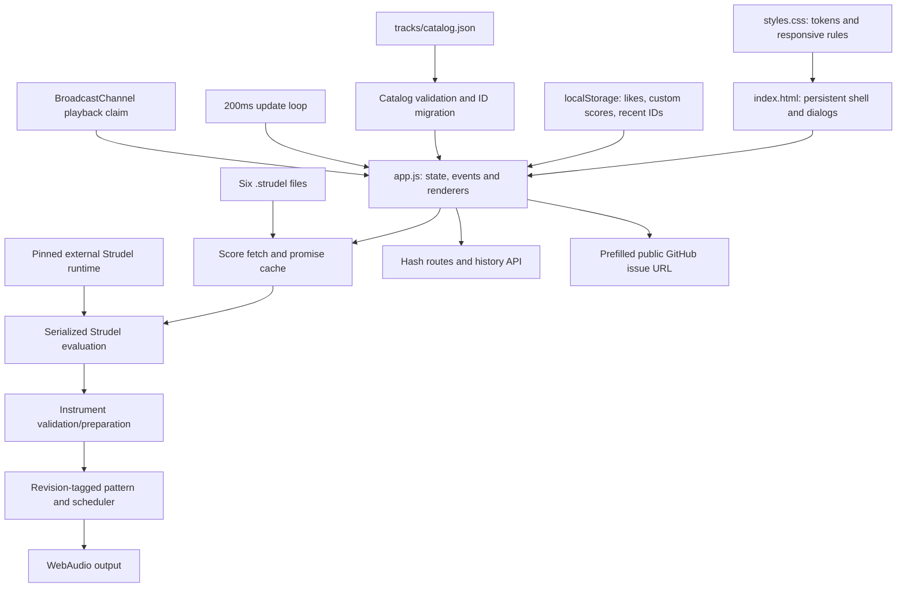

# Strudelify — implementation reconstruction

Audit date: **19 October 2026**. Target: [the public website](https://hustlenix.github.io/strudelify/), currently titled Hustlenix Music, and its matching application source.

This describes **what our website actually implements**. The separate [Spotify reference](../spotify-research/README.md) describes the comparison target. No application or music changes are included in this audit.

## 1. Identity and evidence

| Fact | Evidence |
| --- | --- |
| Live application revision | `609f634fce2e883c5de329eb846504e070ad438c`, from public `release.json` |
| Manifest payload dirty flag | `false` |
| Manifest resource inventory | 26 entries; this audit fetched 10 selected payloads, not all 26 |
| Matching payloads | HTML, CSS, app JavaScript, catalog and all six catalog scores match both manifest hashes and this checkout after newline normalization |
| Research checkout at capture | `1f6bac8abae541bec63a08e9a74c86abb3d24571`; documentation changes sit above the unchanged application |
| Live catalog | Six original instrumentals, all carrying `draft` / unreviewed metadata; public availability does not imply musical approval |
| Evidence files | [Live asset facts](live-assets.json), [capture script](capture_live.py), [control map](controls.csv) |

Evidence classes used below: **HTTP** means current public GET/hash result; **S** means directly read application source; **I** means an inferred consequence or proposed next step. Browser Use still reported disabled after reset, and the web text fetcher failed on the homepage. Ordinary HTTP fetching succeeded. No browser interaction, DOM measurement, playback capture, storage mutation or application test was performed in this pass. Earlier listening/runtime reports are not reclassified as fresh results.

## 2. Actual architecture

The deployed client is a static HTML/CSS/JavaScript application. There is no frontend build framework in the authored client: `index.html` loads `styles.css`, deferred `app.js` and the pinned `@strudel/web@1.2.6` runtime from unpkg. Rendering uses DOM APIs, HTML templates and delegated events. Application state is distributed between a JavaScript object, module variables, DOM inputs/classes and browser history.



**S:** The authored application has no account/session API, shared playlist database, recommendation service, upload endpoint or remote library sync. The profile button explains browser-local storage. The issue action creates a GitHub URL; it does not submit a report automatically. This is a source inventory, not a scan of every possible service on the hosting domain.

## 3. Startup sequence

1. The browser parses the persistent shell and loads CSS plus deferred runtime/application scripts.
2. `app.js:1–35` defines six fallback tracks, palettes/groups and state. Likes, custom tracks and recent IDs are read from localStorage.
3. The application installs cross-tab ownership, caches, delegated actions, view controls, editor handlers, panel and library-resize handlers.
4. `ensureEngine()` is scheduled in a microtask. It initializes the REPL, registers first-gesture audio initialization and hard-silences initial output. Rejection is caught so the rest of the UI can still render.
5. Initial library navigation, Home and player UI render. The notes panel defaults open above 1100px.
6. `loadCoverCatalog()` fetches **`tracks/catalog.json`**. Despite its legacy name, it loads the current originals catalog. It validates the whole array, resolves score URLs and applies the public-content gate before replacing fallback tracks.
7. Saved custom IDs colliding with canonical catalog IDs are renamed to unique `saved-*` IDs, with corresponding liked IDs preserved.
8. Rendering refreshes and route resolution runs in `finally`, including when catalog fetch/validation fails. Failure retains the fallback originals and displays a catalog alert.
9. A separate `release.json` fetch supplies the build identifier used in issue reports.

There is no current fetch of `tracks/covers/catalog.json` in the deployed app. Eight historical cover studies present in the repository are separate from the six-entry live catalog.

## 4. Route reconstruction

| Address / entry | Actual resolution | State outside the address |
| --- | --- | --- |
| Empty hash / `#home` | Home with starter module, quick picks, mood groups and all-track rows | Home filter, recents and current playback |
| `#search` | Search cards from local catalog/custom metadata | Query lives in two input elements; group filter lives in state |
| `#library` | Cards with All / Liked / Made by you filters | Selected filter lives in state |
| `#track/:id` | Track identity/actions, source disclosure and related cards | Detail fetch revision and source cache |
| `#track` with history track ID | Resolve that stored ID | Depends on `history.state` |
| Unknown view | Falls back to Home | No dedicated not-found view |
| Unknown track ID | Home plus a toast explaining the track is unavailable | No audio start occurs just from opening details |
| Create buttons | Native HTML dialog; no creator route | Form fields, preview session and dialog state |

`setView()` uses `pushState`; `routeFromLocation()` handles startup and `popstate`. Main scroll resets to top on view changes. Query, group filter, sort and scroll position are not fully encoded in the URL. Therefore the URL alone cannot reconstruct an exact search session. Track details do have an ID-bearing deep link.

## 5. State and persistence map

| State location | Contents | Lifetime |
| --- | --- | --- |
| `state` object | Current track; playing/paused/loading flags; likes/custom/recent; library/group filters | In-memory, except three saved arrays |
| Module variables | REPL promise/instance; duration; playback revision; evaluation chain; start clock; preview/error/abort; caches; detail/lyrics revisions; library width; Home filter | Current page |
| DOM | Search text, dialog contents, selected classes, collapsed library and open right panel | Current document |
| History/hash | View and selected track ID | Browser navigation |
| `strudelify-liked` | Array of saved track IDs | This origin/browser profile |
| `strudelify-custom` | Array of custom objects containing full executable score text | This origin/browser profile |
| `strudelify-recent` | At most six deduplicated track IDs, newest first | This origin/browser profile |
| `BroadcastChannel('strudelify-playback')` | A `claim` message tells another app tab to stop | Compatible currently open same-origin contexts |

The library is not a playlist repository. `renderPlaylistNav()` creates buttons for All patterns, three hard-coded mood groups and Liked tracks. Those buttons filter/search; they do not store ordered playlist membership. Library All renders all available tracks, not only saved entities.

Recents is updated after successful non-preview start, without a minimum listening threshold. It records unique IDs rather than repeated listening sessions. Custom tracks are prepended when saved; there is no implemented edit/delete/export workflow for them in the current source.

## 6. Playback, step by step

### Start (`app.js:165`)

1. Re-selecting the current track through a play action while playing/loading calls **Stop**.
2. Otherwise increment `playbackRevision`, abort the preceding wait, broadcast ownership and reset playback flags/duration.
3. Hard-silence old output; select the new track; load notes and render a loading state.
4. Obtain engine and score concurrently. A score fetch has a 15-second timeout; its promise is cached by track ID and evicted on error.
5. Queue evaluation on `evaluationQueue`. Re-check the owning revision around async boundaries.
6. Evaluate score without starting. Reject evaluation errors or values that do not expose `queryArc`.
7. Query up to a bounded cycle horizon, check instrument names against the sound map and load required sample buffers with a timeout.
8. Tag emitted values with `_strudelifySession`, install the pattern, reset/silence old effects and resume AudioContext.
9. Mark playing, start the REPL, then record the AudioContext clock origin. Only a still-current revision may complete this path.
10. Extract finite duration from a source-text declaration matching `const endSeconds` or `const sourceDuration`; update recents for real tracks.

The output callback rejects events whose session tag does not match the current revision. This is a material stale-audio guard and must survive refactoring.

### Pause / resume (`247`)

The central transport suspends/resumes AudioContext. The scheduler's time source is preserved, so this path retains score phase. Resume claims cross-tab ownership and guards late completion against newer intent. This differs from clicking a currently playing card/row, whose delegated play action calls Stop.

### Stop (`232`, `129`)

Stop increments the revision, aborts outstanding waits, clears playing/paused/loading/preview/error/duration and invokes hard silence. Hard silence stops the REPL, calls `hush`, disconnects effects and suspends the actual audio context. It preserves the selected track in the UI. Closing/canceling an active preview and `pagehide` also use Stop.

### Finite ending (`382–398`)

A 200ms interval derives elapsed time from AudioContext and checks `playbackDuration + 1`. Once that threshold is reached it calls Stop. There is no queue resolver, Repeat state, explicit Ended state or automatic Next command. The catalog contains `durationSeconds`, but this current end detector reads duration from the score declaration instead. Malformed/absent declarations can therefore change end handling independently of catalog metadata.

### Source and notes are separate async paths

`openTrack()` uses `detailRevision` to stop a late source response from replacing newer details. Lyrics/notes has its own revision/cache and validates cue data. Lyrics retrieval is conditional on cleared rights; current catalog loading rejects `lyricsUrl` entirely, so the public release shows instrumental notes rather than attached lyrics. The notes updater also owns finite-ending detection—a coupling worth separating later.

## 7. Discovery, library and creator behavior

- **Home:** recents are merged with all tracks by ID, then quick picks are capped at eight. Mood collections are three hard-coded metadata groups. No recommendation ranking service is called.
- **Search:** trimmed lowercase substring matching across title, artist, mood and group; an optional exact group match. Suggestions show the first five matches plus a view-all action. No server search, album/artist entity index, fuzzy matching or query operators are implemented.
- **Library:** filters for liked IDs and created flags; no stored user playlists or folder hierarchy.
- **Queue:** `renderQueue()` maps `allTracks()` into immediate-play buttons. It stores no upcoming list, occurrence IDs, manual entries or context cursor.
- **Previous/Next:** wraps through `allTracks()` by current track ID, independently of the visible filtered collection.
- **Shuffle:** toggles a button class and immediately invokes `playRandom()`. Later Next does not consult that class or a shuffle state.
- **Creator:** starts with a template or track object supplied by a caller; Preview executes the current textarea through the same playback engine as a synthetic `editor-preview` track. Saving creates a `custom-${Date.now()}` ID and stores raw code locally. Closing a preview stops it. The form requires nonempty title/code, but saving does not require a successful preview.
- **View code/copy:** details fetch and display the source; Clipboard API copies only on explicit action. Code viewing changes the route without starting a track.
- **Volume/profile:** both are informational toast actions. There is no in-app master gain slider, authentication or account menu behind them.

## 8. Layout implementation

`styles.css` contains the black/charcoal tokens, 280px library baseline, 32px collapsed right rail and card sizing. Component blocks cover the global header, library, main content, cards/rows, detail header, notes/queue, transport, editor and responsive states. Multiple media-rule groups occur around 1400, 1100, 760 and 540px, plus reduced-motion handling. These are authored rules, not fresh measurements of the rendered page.

Library resizing is bounded to 220–420 in JavaScript, supports pointer capture and 10px keyboard steps, and is not persisted. Collapsing clears the inline width. Queue and notes use mutually exclusive shell classes and update expanded attributes. Desktop notes default open; narrow layouts rely on different panel positioning rules. This combination needs a later rendered resize/modal interaction audit.

## 9. Concrete gaps and failure paths

These are **source findings**, not newly reproduced browser failures:

| ID | Source anchor | Finding and consequence |
| --- | --- | --- |
| F01 | `342`, `571–579` | Queue/shuffle/next are independent catalog actions. There is no durable listening order to reproduce the Spotify queue behavior. |
| F02 | `384` | A finite ending stops; it does not advance. Completion behavior currently lives inside a notes/lyrics function. |
| F03 | `312`, `326`, `167`, `247` | Row shows a pause glyph while its action stops; card label remains Play. Main transport truly pauses. Control intent is inconsistent across surfaces. |
| F04 | `600–614` | Custom state is prepended before storage succeeds. A failed durable write can leave an unsaved in-memory entry while the dialog stays open. Repeated Save may create more entries. |
| F05 | `477–482` | Like state mutates before storage, and success toast ignores `saveStorage` failure. A refresh can lose an apparently saved like. |
| F06 | `64–70`, `75` | Storage read validates the outer array only. A malformed custom item can reach rendering/property access. Item-level schema validation is missing. |
| F07 | `95–103` | Source promise cache is keyed only by ID; a successful old score remains cached in the current page even if that ID's remote content changes. |
| F08 | `429–440`, `620` | Address/history omits query/filter/scroll reconstruction. Back to Search need not recreate the original result state from the address alone. |
| F09 | `212`, `384`, catalog | Source-regex duration and catalog duration are separate authorities. Centralize duration/capability metadata with an explicit validation policy. |
| F10 | `126`, `190`, `600` | Custom code is executable in the application runtime. This is a local creator feature, not a sandbox or a ready public user-submission system. |
| F11 | index script tags | Runtime delivery depends on the external pinned CDN script. No offline service-worker/cache readiness or alternate runtime loader is present in authored code. |
| F12 | `296`, `249`, `552` | Main Play is disabled before selection, while the global Space path can select a random track. This is a discoverability/consistency decision to review. |

These findings should become narrow implementation tasks. They are not a reason to replace the entire app. Preserve revision ownership, serialized evaluation, instrument preparation, hard silence, preview cleanup, local-user-data preservation and source-view access.

## 10. Upgrade seams

1. Expose the existing engine functions behind a playback adapter, retaining their cancellation semantics.
2. Introduce a real queue/context/history resolver and explicit shuffle/repeat/ended state.
3. Make cards, rows and central transport dispatch consistent named intents from one snapshot.
4. Add a playlist repository with occurrence IDs and atomic storage writes; migrate existing likes/custom scores without clearing them.
5. Put route query/filter restoration, UI preferences and panel modality into explicit view state.
6. Separate finite timing from notes, and separate local code creation from any future public publishing/trust boundary.

The [Spotify architecture mapping](../spotify-research/ARCHITECTURE.md) already defines proposed module/data boundaries. This audit now grounds those proposals in the exact live payload and actual code paths.

## Reproduce

```powershell
rtk proxy python -X utf8 C:\Users\LalithReddy.b\strudelify-research\docs\strudelify-research\capture_live.py
```

The command refreshes the facts report through public GETs. It does not interact with the website or run tests. A future browser pass should observe exact route rendering, canceled loading, keyboard/suggestion behavior, storage-denied saves, panel resize and active transport states. Those outcomes remain separate from this source reconstruction.
