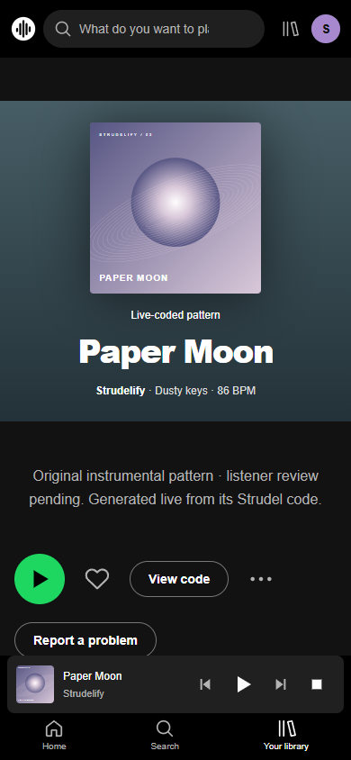
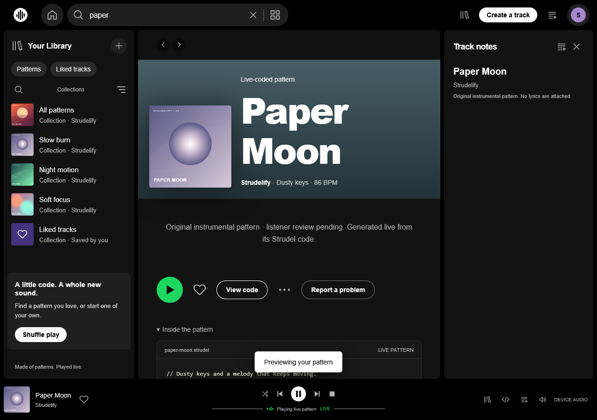
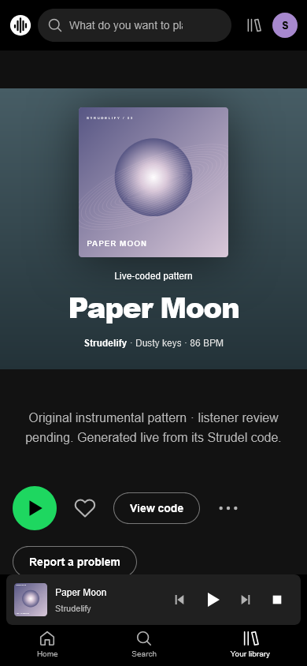

# Review checkpoint

Exact tested source commit: `d030f75b7ab5865b1037bca39864476737ef7034`. Later report-only commits can carry this evidence;
the ten runtime payload hashes in final-result.json must still match the tested artifact.

- Chromium 155.0.8059.82: 18/18 passed.
- Firefox 153.0: 18/18 passed.
- Fresh existing public baseline: 17 checks passed and 28 resources match main `0b6e42ce2fc1f236df8f673470724a564a1d1c5f`.
- Proposed candidate is local only: http://127.0.0.1:4189/.
- Private title-blind music comparisons: http://127.0.0.1:4188/.
- Six original synth patterns in the proposed public artifact; eight commercial studies preserved for review.
- 16 original recording copies and 62 preserved music/art/lyric resources verified.
- Public GitHub feedback draft/form added; real listener submissions are not fabricated.
- Human music approval and publication/naming/license gates remain open. No new arrangements started.

## Actual screenshots

Read RELEASE_CANDIDATE.md, MUSIC_RECOGNITION.md, RESOURCE_DECISIONS.md and THIRD_PARTY_ASSETS.md
for scope, remaining faults and decisions. This checkpoint is review-ready; it is not a claim
that all eight songs are recognizable or that the proposed artifact has been publicly released.
